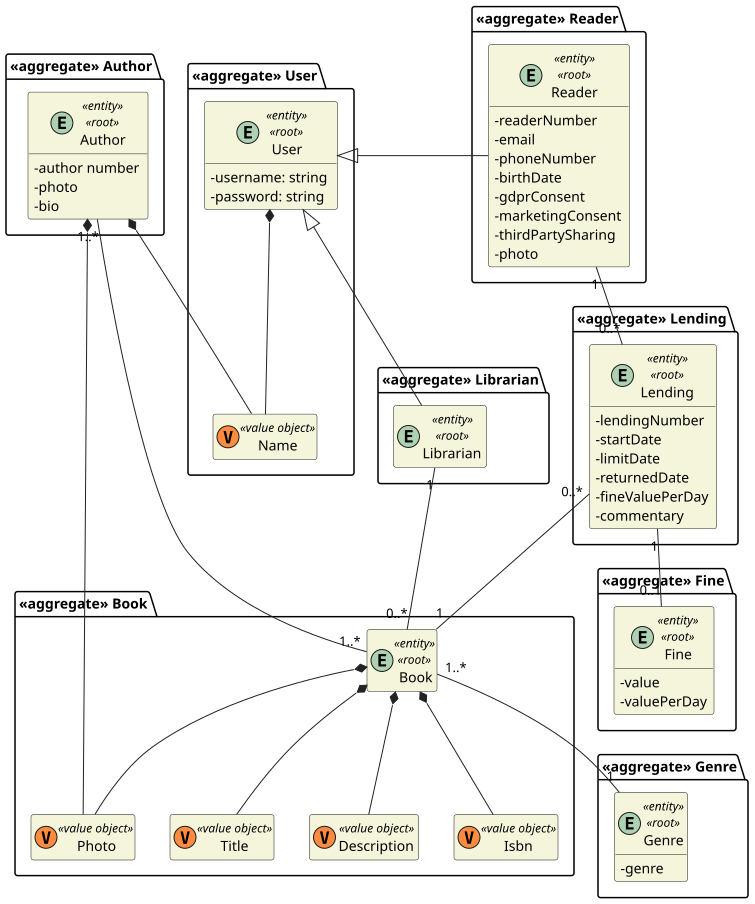
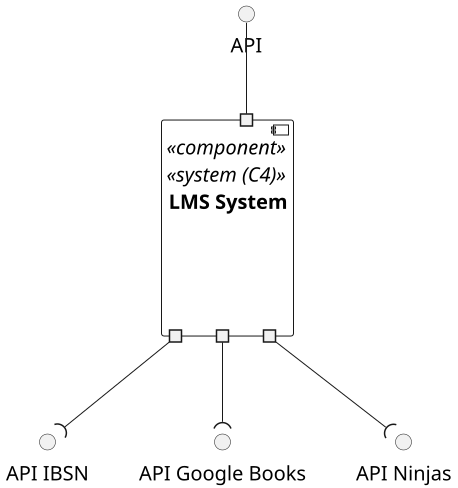
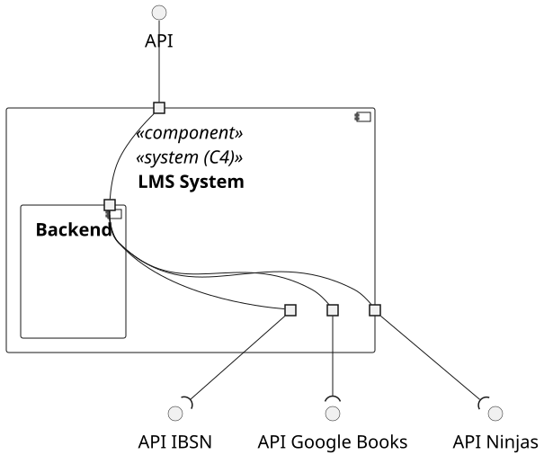
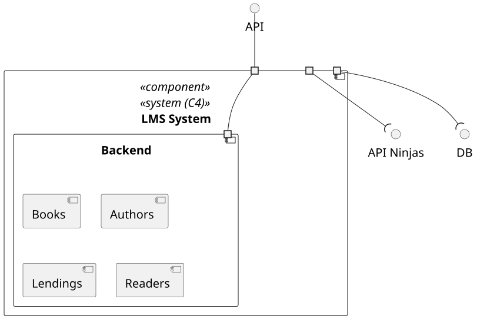
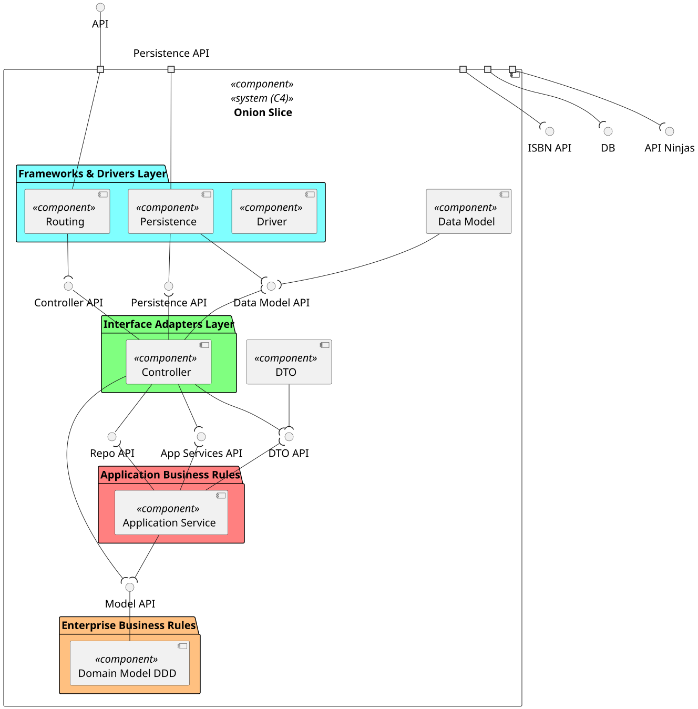
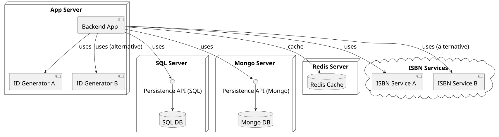
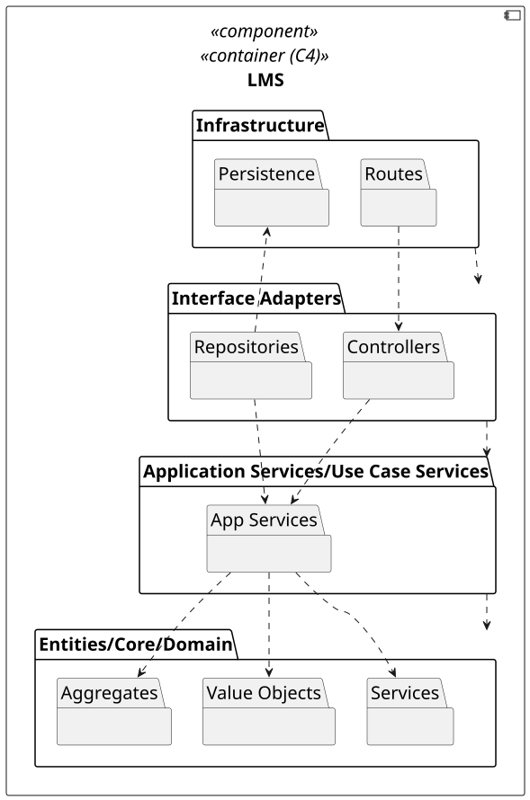
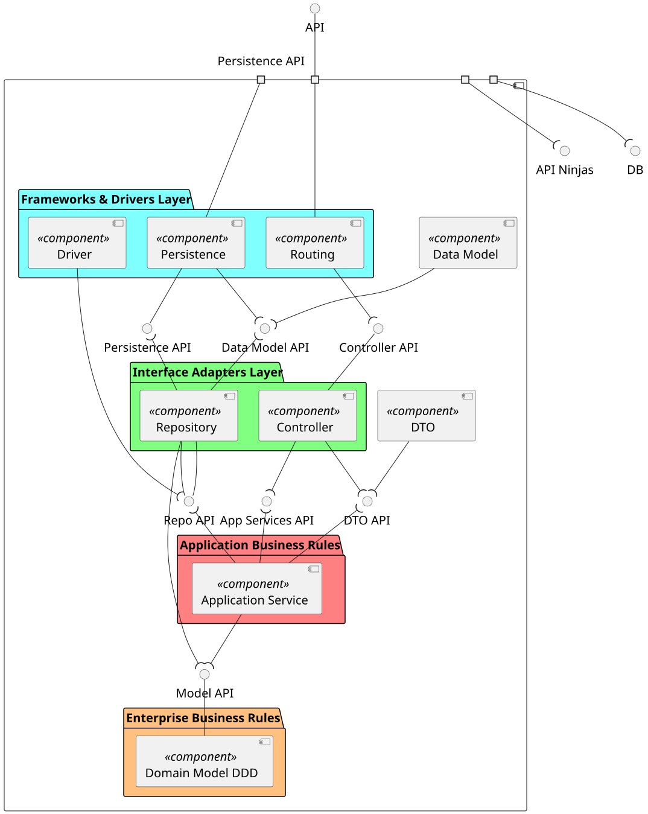
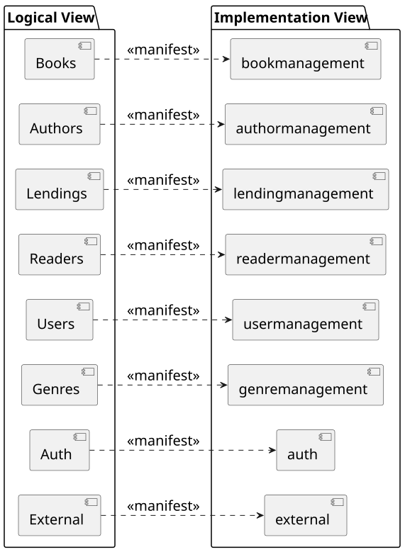
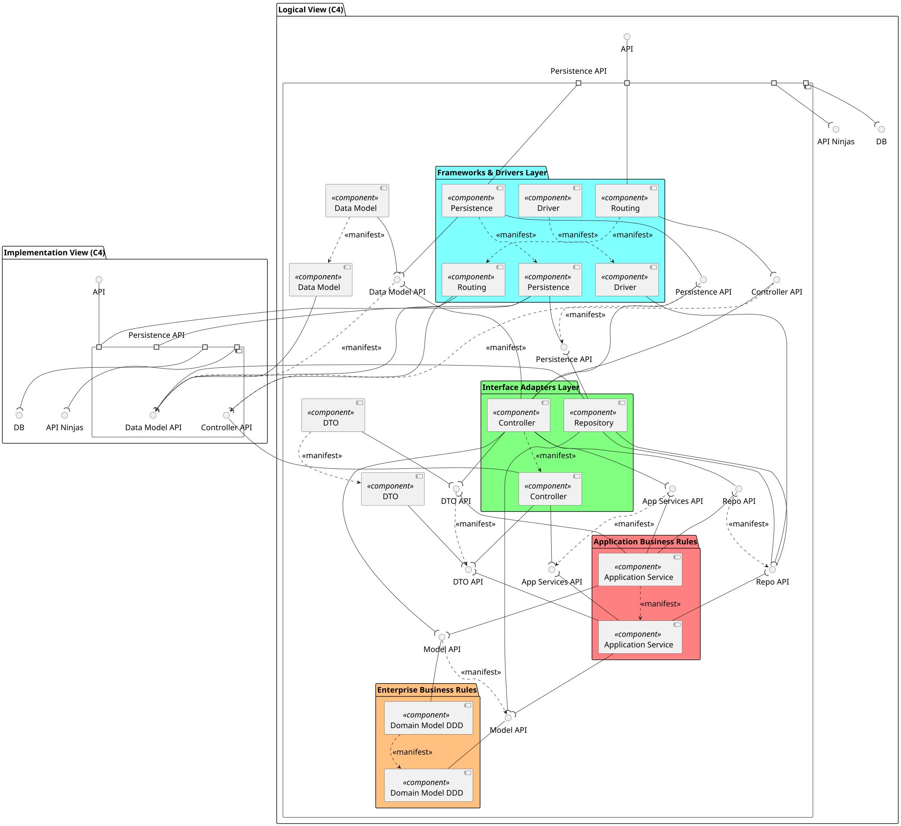

# Global Artifacts

- [Global Artifacts](#global-artifacts)
  - [Domain Model](#domain-model)
  - [C4 Model](#c4-model)
    - [Logical](#logical)
      - [Level 1](#level-1)
      - [Level 2](#level-2)
      - [Level 3](#level-3)
      - [Level 4](#level-4)
    - [Deployment](#deployment)
    - [Implementation](#implementation)
      - [Level 3](#level-3-1)
      - [Level 4](#level-4-1)
    - [Manifests](#manifests)
      - [Logical - Implementation Level 3](#logical---implementation-level-3)
      - [Logical - Implementation Level 4](#logical---implementation-level-4)

## Domain Model

## C4 Model

### Logical

#### Level 1

#### Level 2

#### Level 3

#### Level 4

### Deployment

### Implementation

#### Level 3

#### Level 4

### Manifests

#### Logical - Implementation Level 3

#### Logical - Implementation Level 4

