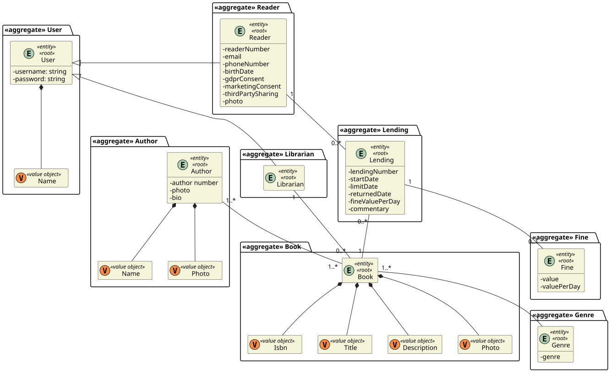
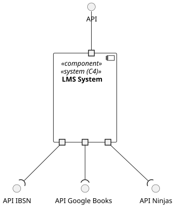
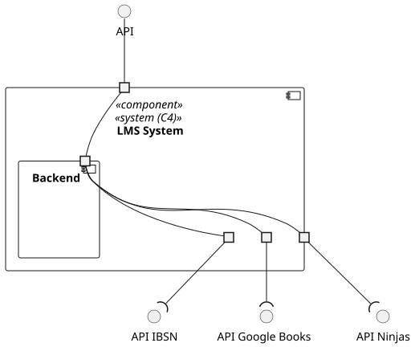
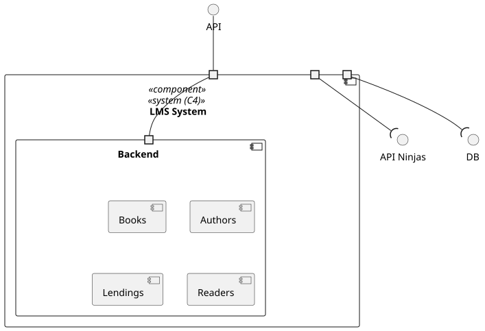
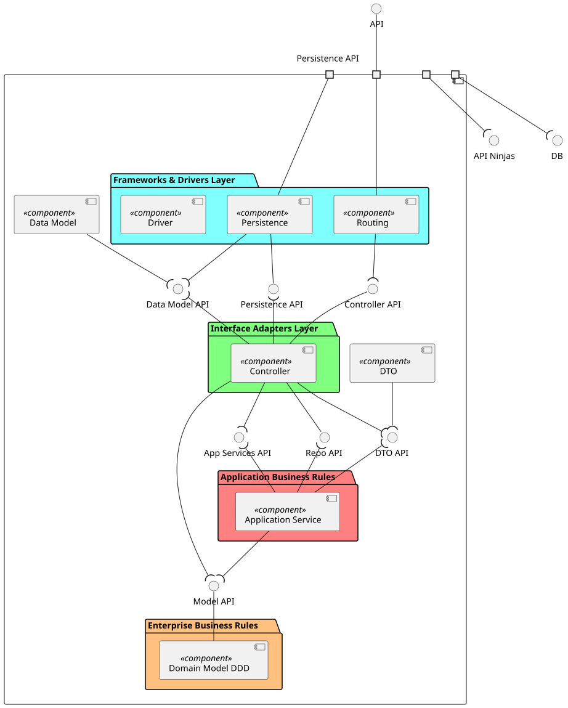
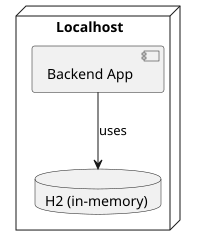
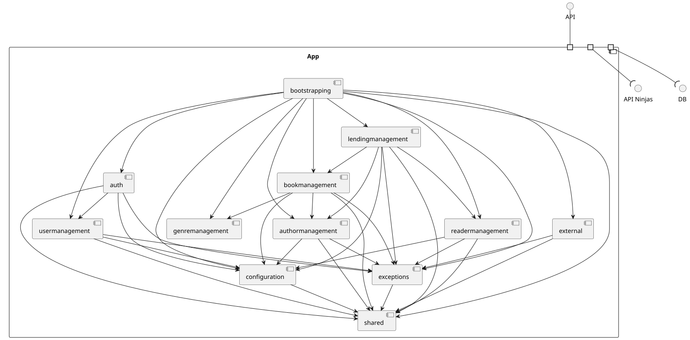
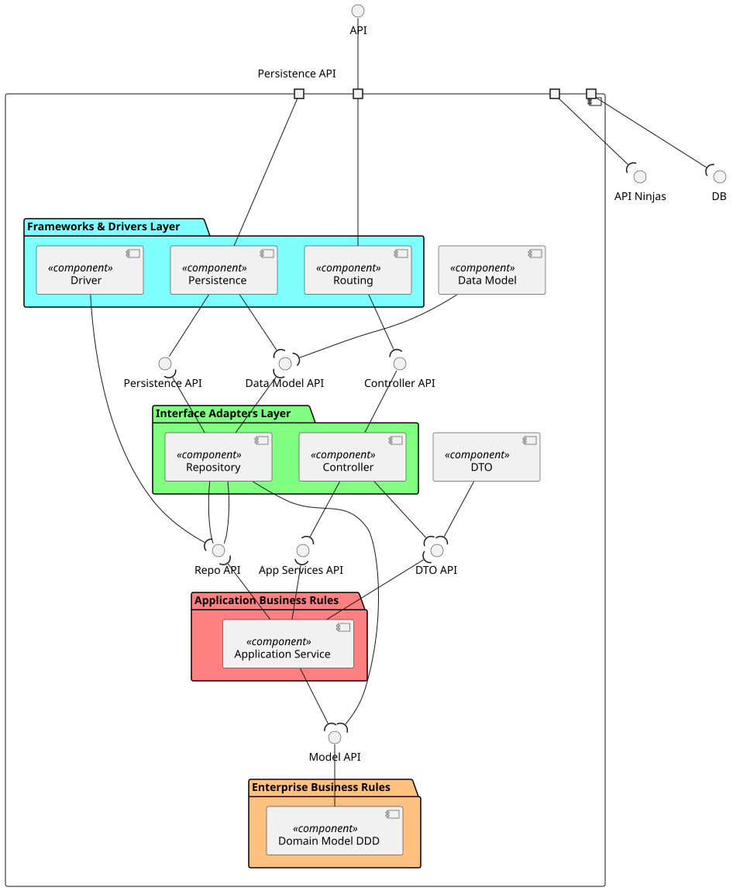
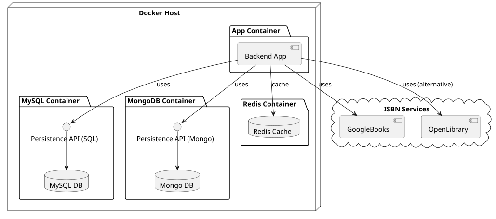
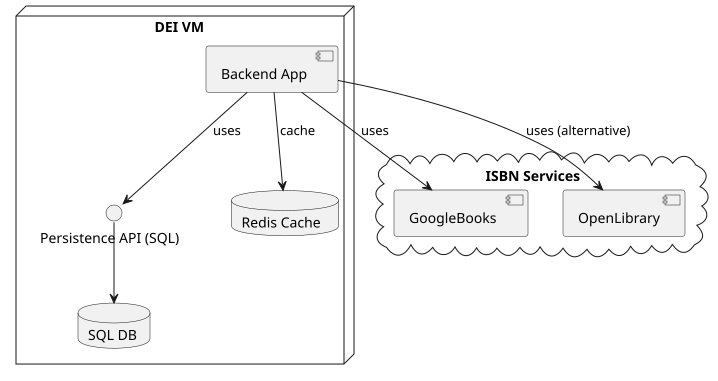

# System Documentation and Analysis

## 1. System Overview

Brief description of the system, its purpose, and scope.

---

## 2. System-as-is

### 2.1 Architecture and Design

#### 2.1.1 Global Artifacts

- **Domain Model**
  

- **C4 Model**

  **Logical View**

  - Level 1: 
  - Level 2: 
  - Level 3: 
  - Level 4: 

  **Deployment View**

  - 

  **Implementation View**

  - Level 3: 
  - Level 4: 

### 2.3 Test Health Metrics

#### 2.3.1 Quantity

- **Total Classes**: 150+
- **Total Methods**: 588 (477 missed, 111 covered)
- **Total Lines**: 2,745 (2,278 missed, 467 covered)
- **Total Instructions**: 15,888 (13,755 missed, 2,133 covered)
- **Total Branches**: 1,791 (1,728 missed, 63 covered)
- **Total Complexity**: 1,275 (1,085 missed, 190 covered)

#### 2.3.2 Quality / Coverage

The project does not have any plugin that enables to analise test coverage metrics. Jacoco plugin was used to analise the project coverage:

| Package             | Instruction Coverage | Branch Coverage | Line Coverage |
| ------------------- | -------------------- | --------------- | ------------- |
| `readermanagement`  | ~10%                 | ~0%             | ~10%          |
| `authormanagement`  | ~15%                 | ~0%             | ~15%          |
| `bookmanagement`    | ~12%                 | ~0%             | ~12%          |
| `genremanagement`   | ~8%                  | ~0%             | ~8%           |
| `lendingmanagement` | ~25%                 | ~5%             | ~25%          |
| `usermanagement`    | ~20%                 | ~5%             | ~20%          |
| `shared`            | ~30%                 | ~5%             | ~25%          |
| `configuration`     | ~95%                 | 100%            | ~95%          |
| `external.service`  | ~15%                 | 0%              | ~10%          |
| `bootstrapping`     | 0%                   | 0%              | 0%            |

> **Observation:** Most core business logic (controllers, services, DTOs) is largely untested. Coverage is concentrated in configuration and some utility classes.

## 3. System-to-be (Deployment Only)

### 3.1 Environment Setup

The system will have **three environments**:

**Development (dev)**

- Docker-based deployment.
- Each service (Backend App, MySQL, MongoDB, Redis) runs in its own container.
- Allows developers to test locally in an isolated environment.
- Ports mapped to host for easy debugging.
- External dependencies (ISBN Services) remain cloud-based.
- 

**Staging & Production (prod)**

- Same deployment structure.
- Backend App and database modules run on dedicated VM.
- Includes Redis cache for performance.
- External cloud services remain the same (GoogleBooks / OpenLibrary).
- 

---

### 3.2 CI/CD Pipeline

The pipeline will follow the **same stages across all environments**, adapted to the environment-specific deployment targets:

**Pipeline Stages:**

1. **Checkout**

   - Retrieve source code from SCM (Git).

2. **Build**

   - Compile sources and resolve dependencies (`mvn clean compile -DskipTests`).

3. **Static Analysis**

   - Run SonarQube analysis to enforce code quality.

4. **Unit Tests**

   - Execute fast, isolated tests and collect reports.

5. **Integration Tests**

   - Deploy to a temporary environment (Docker for dev or staging VM) and run end-to-end tests.

6. **Mutation Tests**

   - Assess test effectiveness via PIT mutation testing.

7. **Package**

   - Produce the deployable artifact (JAR) and archive it for deployment.

8. **Deploy**
   - **Dev:** Deploy to local Docker containers.
   - **Staging:** Deploy to staging VM
   - **Prod:** Deploy to production VM

**Pipeline Notes:**

- Environment variables (e.g., SonarQube credentials) are configured for secure access.
- Artifacts are versioned and fingerprinted to ensure traceability.
- Post-build actions report success/failure clearly to developers and ops teams.
- Staging acts as a final verification step before production deployment.

---

### 3.3 Scaling and Reliability Improvements

- **Dev Environment:** Lightweight, containerized services for fast feedback loops.
- **Staging/Production:** Dedicated VMs allow scaling databases and caching layers independently.
- **Redis Cache:** Reduces database load in staging and prod.
- **CI/CD Pipeline:** Automates testing, static analysis, and deployment to reduce human error and accelerate delivery.
- **Future Enhancements:** Could introduce container orchestration (e.g., Kubernetes) for prod to improve scalability and resilience.

---

## 4. Critical Analysis of the Pipeline

### 4.1 Performance Metrics

- Latency, throughput, and resource utilization
- Error/failure rates
- Monitoring and alerting insights

### 4.2 Evidence of Improvement Over Time

- Historical metrics comparison (charts, tables)
- Before vs after optimizations
- Lessons learned

### 4.3 Recommendations

- Further optimizations
- Risk assessment
- Long-term maintenance strategies

---

## 5. Appendices

- References
- Glossary of terms
- Additional diagrams or charts
