# Documentação - Sistema de Gestão de Biblioteca (LMS)

Este documento contém a documentação completa da arquitetura **System-To-Be** do projeto LMS (Library Management System) baseado em micro-serviços.

- [Documentação - Sistema de Gestão de Biblioteca (LMS)](#documentação---sistema-de-gestão-de-biblioteca-lms)
  - [Documentos](#documentos)
  - [Como Iniciar os Micro-serviços](#como-iniciar-os-micro-serviços)
    - [Iniciar todos os serviços (primeira vez ou após reboot)](#iniciar-todos-os-serviços-primeira-vez-ou-após-reboot)
    - [Rebuild e redeploy (após alterações de código)](#rebuild-e-redeploy-após-alterações-de-código)
    - [Parar todos os serviços](#parar-todos-os-serviços)
    - [Verificar status dos serviços](#verificar-status-dos-serviços)
    - [Troubleshooting](#troubleshooting)
  - [Requisitos funcionais entregues](#requisitos-funcionais-entregues)
    - [RF1: Criação atómica de Livro com Autores e Género](#rf1-criação-atómica-de-livro-com-autores-e-género)
    - [RF2: Criação atómica de Reader com User](#rf2-criação-atómica-de-reader-com-user)
    - [Tabela comparativa de features](#tabela-comparativa-de-features)
      - [Vista Lógica](#vista-lógica)
      - [Vista de Implementação](#vista-de-implementação)
    - [Diagramas de Comunicação](#diagramas-de-comunicação)
    - [Diagramas de Deployment](#diagramas-de-deployment)
    - [Diagramas de Sequência](#diagramas-de-sequência)
    - [Diagramas de Domínio](#diagramas-de-domínio)
  - [Como Gerar os Diagramas](#como-gerar-os-diagramas)
    - [Pré-requisitos](#pré-requisitos)
    - [Gerar diagramas](#gerar-diagramas)
  - [Referências](#referências)

## Documentos

- [SystemToBe-Architecture.md](./SystemToBe-Architecture.md)
- [Performance Testing.md](../load/readme.md)

Documento principal que descreve:

- Análise comparativa System-As-Is (monolítico) vs System-To-Be (micro-serviços)
- Arquitetura de micro-serviços detalhada
- Descrição de cada micro-serviço (responsabilidades, tecnologias, endpoints)
- Comunicação via RabbitMQ (event-driven architecture)
- Padrões de persistência (database per service)
- Deployment com Docker/Docker Compose/Docker Swarm
- Segurança (JWT, RBAC)
- Qualidade e testes
- Roadmap de melhorias futuras

## Como Iniciar os Micro-serviços

O projeto disponibiliza scripts na raiz (`p2/`) para gestão centralizada de todos os micro-serviços:

### Iniciar todos os serviços (primeira vez ou após reboot)

```bash
cd ArqSoft-p1/p2
chmod +x restart-all.sh
./restart-all.sh
```

**O que faz**:

1. Inicializa Docker Swarm (se inativo)
2. Cria rede overlay `lms_overlay_attachable_network`
3. Inicia RabbitMQ compartilhado (porta 5672 + Management UI 15672)
4. Constrói imagens Docker de todos os micro-serviços (Maven + Docker build)
5. Inicia todos os 5 micro-serviços com 2 réplicas cada
6. Cada serviço cria suas próprias bases de dados (PostgreSQL ou MySQL)

**Portas dos serviços**:

- **lms-authnusers**: http://localhost:8084 (Autenticação/Utilizadores)
- **lmsbooks**: http://localhost:8087 (Livros/Autores)
- **lmsgenres**: http://localhost:8088 (Géneros)
- **lmsreaders**: http://localhost:8090 (Leitores)
- **lmslendings**: http://localhost:8092 (Empréstimos)
- **RabbitMQ Management**: http://localhost:15672 (guest/guest)

### Rebuild e redeploy (após alterações de código)

```bash
cd ArqSoft-p1/p2
chmod +x redeploy-all.sh
./redeploy-all.sh
```

**O que faz**:

1. Maven clean package de cada micro-serviço (skip tests)
2. Docker build de nova imagem
3. Docker service update com nova imagem
4. Mostra status final dos serviços

### Parar todos os serviços

```bash
cd ArqSoft-p1/p2
chmod +x shutdown-all.sh
./shutdown-all.sh
```

**O que faz**:

- Executa `./shutdown.sh` em cada pasta de micro-serviço
- Remove stacks Docker Swarm
- Para containers PostgreSQL e RabbitMQ

### Verificar status dos serviços

```bash
# Listar serviços Swarm
docker service ls

# Listar containers ativos
docker ps --format "table {{.Names}}\t{{.Status}}\t{{.Ports}}"

# Ver logs de um serviço específico
docker service logs lmsbooks_lmsbooks --tail 100 --follow

# RabbitMQ Management UI
http://localhost:15672
# Credenciais: guest/guest
```

### Troubleshooting

**Serviços não iniciam**:

```bash
# Verificar logs
docker service logs <service_name> --tail 50

# Verificar health dos containers
docker ps --filter "health=unhealthy"
```

**RabbitMQ não conecta**:

```bash
# Verificar RabbitMQ está ativo
docker ps | grep rabbitmq

# Ver logs RabbitMQ
docker logs rabbitmq --tail 100
```

**PostgreSQL connection errors**:

```bash
# Verificar DBs criadas
docker ps | grep "_db_"

# Conectar a uma DB específica
docker exec -it books_db_1 psql -U books -d booksDB
```

## Requisitos funcionais entregues

### RF1: Criação atómica de Livro com Autores e Género

**Endpoint**: `POST /api/books/create-with-authors-and-genre`  
**Autenticação**: Bearer token com role LIBRARIAN  
**Content-Type**: application/json

**Request Body**:

```json
{
  "isbn": "9788535933872",
  "title": "Neuromancer",
  "description": "Cyberpunk classic by William Gibson",
  "genre": "cyberpunk",
  "authors": [
    {
      "name": "William Gibson",
      "bio": "American-Canadian author and futurist"
    }
  ]
}
```

**Fluxo de processamento**:

1. Criação de autores: para cada autor no request, cria Author via AuthorService.create() e recolhe authorIds
2. Garantia de género local: verifica se género existe em Books DB; se não, cria Genre local e publica Genre.Created
3. Criação de livro: monta CreateBookRequest com authorIds e género, cria Book e publica Book.Created
4. Sincronização assíncrona: Genres consome Book.Created, extrai campo genre, cria género local se não existir e publica Genre.Created para Readers

**Response**: 201 Created com BookView (isbn, title, description, genre, authors)

**Validações**:

- ISBN único (`ConflictException` se já existe)
- Título e descrição obrigatórios
- Pelo menos 1 autor
- Nome de autor obrigatório

**Verificação**:

```sql
-- Books DB
SELECT * FROM genre WHERE genre='cyberpunk';
SELECT * FROM book WHERE isbn='9788535933872';
SELECT * FROM author WHERE name LIKE '%Gibson%';

-- Genres DB
SELECT * FROM genre WHERE genre='cyberpunk';

-- Readers DB
SELECT * FROM genre WHERE genre='cyberpunk';
```

**Estado**: Implementado e testado com ISBN 9788535933872

---

### RF2: Criação atómica de Reader com User

**Endpoint**: `POST /api/readers/create-with-user`  
**Autenticação**: Bearer token com role LIBRARIAN  
**Content-Type**: application/json

**Request Body**:

```json
{
  "email": "carlos.mendes@example.com",
  "fullName": "Carlos Mendes",
  "password": "MyPassword123"
}
```

**Fluxo de processamento**:

1. Validação de email único em Readers DB (ConflictException se já existe)
2. Validação de password: mínimo 8 caracteres, 1 maiúscula, 1 minúscula, 1 número ou carácter especial
3. Codificação de password com BCrypt
4. Criação de Reader: Reader.newReader(email, encodedPassword, fullName)
5. Persistência em Readers DB com geração de reader number (formato 2026/001)
6. Publicação de evento User.Created no exchange LMS.readers
7. Sincronização assíncrona: AuthnUsers consome User.Created e cria utilizador local com password temporária "TempPassword123!"

**Response**: 201 Created com ReaderView (readerNumber, name, email)

**Validações**:

- Email formato válido (@Email annotation)
- Email único em Readers
- Password regex: `^(?=.*[a-z])(?=.*[A-Z])(?=.*[0-9\W]).{8,}$`
- Nome obrigatório (mínimo 1 carácter)

**Idempotência**:

- AuthnUsers verifica username com findByUsername antes de criar
- Se evento User.Created chegar duplicado, retorna utilizador existente sem erro

**Verificação**:

```sql
-- Readers DB
SELECT username, name, dtype FROM t_user
WHERE username = 'carlos.mendes@example.com';

-- AuthnUsers DB
SELECT username, name, dtype FROM t_user
WHERE username = 'carlos.mendes@example.com';
```

**Logs esperados**:

```plaintext
[Readers] Send User event to AMQP Broker: carlos.mendes@example.com [USER_CREATED]
[Readers] User event sent successfully: carlos.mendes@example.com
[AuthnUsers] AuthnUsers received User Created by AMQP: carlos.mendes@example.com
[AuthnUsers] New user synchronized in AuthnUsers: carlos.mendes@example.com
```

**Troubleshooting**:

- Se utilizador aparece em Readers mas não em AuthnUsers: verificar logs de AuthnUsers para erros de validação de password
- Erro "Given Password is not valid": password temporária não cumpre regex (deve ser TempPassword123!)
- Se evento não chega: verificar RabbitMQ Management UI (`http://localhost:15672`) para queues e bindings

**Estado**: Implementado e testado com `carlos.mendes@example.com`

---

### Tabela comparativa de features

| Aspeto                  | RF1: Book+Authors+Genre                       | RF2: Reader+User                                                  |
| ----------------------- | --------------------------------------------- | ----------------------------------------------------------------- |
| **Endpoint**            | POST /api/books/create-with-authors-and-genre | POST /api/readers/create-with-user                                |
| **Serviço origem**      | Books                                         | Readers                                                           |
| **Serviços destino**    | Genres, Readers                               | AuthnUsers                                                        |
| **Exchange**            | LMS.books, LMS.genres                         | LMS.readers                                                       |
| **Routing keys**        | Book.Created, Genre.Created                   | User.Created                                                      |
| **Entidades criadas**   | Author(s), Genre, Book                        | Reader, User                                                      |
| **Sincronização**       | Books → Genres → Readers                      | Readers → AuthnUsers                                              |
| **Validação principal** | ISBN único, autores obrigatórios              | Email único, password complexa                                    |
| **Idempotência**        | Verifica género existente antes de criar      | Verifica username existente antes de criar                        |
| **Password**            | N/A                                           | Codificada com BCrypt (real em Readers, temporária em AuthnUsers) |
| **Teste base**          | 9788535933872 "Neuromancer"                   | `carlos.mendes@example.com`                                       |

---

#### Vista Lógica

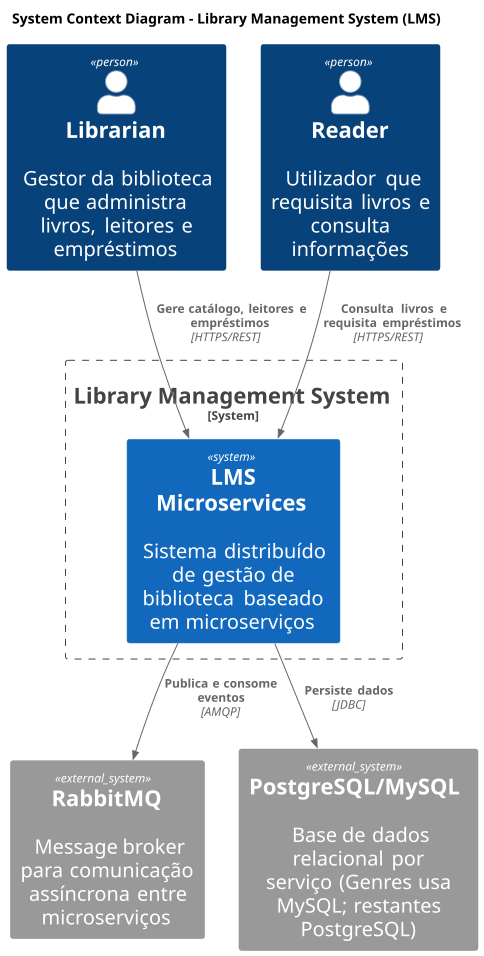

- Visão geral do sistema no seu contexto
- Atores: Librarian, Reader
- Sistemas externos: RabbitMQ, PostgreSQL
- Interações de alto nível

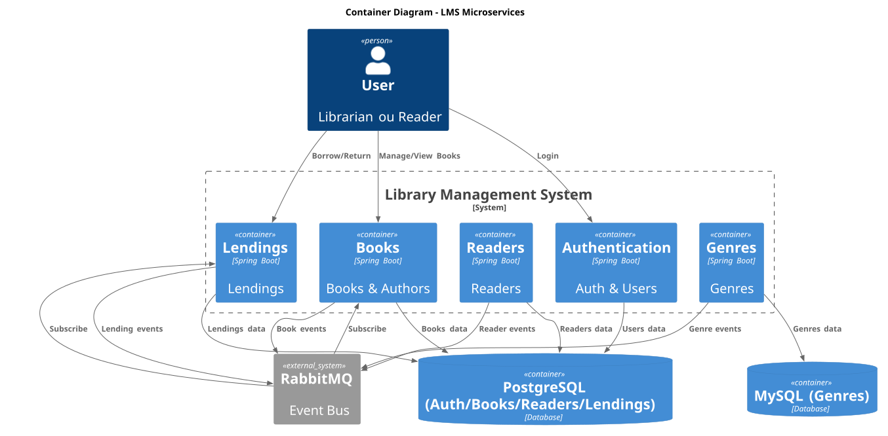

- Decomposição em containers (micro-serviços)
- Todos os 5 micro-serviços:
  - lms-authnusers
  - lms-books
  - lms-genres
  - lms-readers
  - lms-lendings
- Bases de dados independentes por serviço
- Fluxos de comunicação REST e AMQP

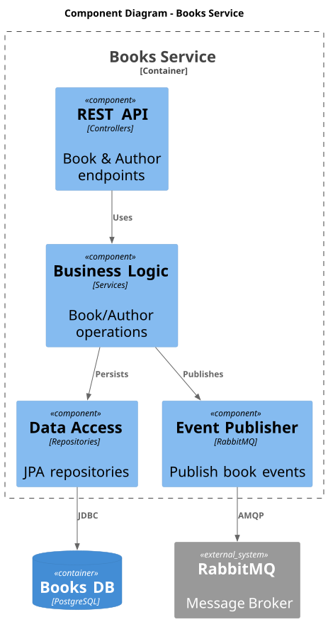

- Estrutura interna do micro-serviço lms-books
- Controllers, Services, Repositories
- Event Publishers e Consumers
- Interações entre componentes

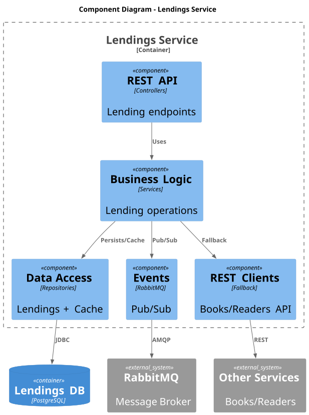

- Estrutura interna do micro-serviço lms-lendings
- Padrão Cache-Aside com fallback REST
- Event-driven consumers
- Validation e Fine services

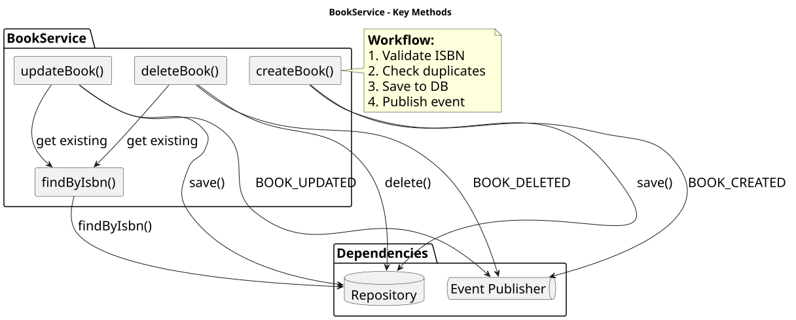

- Métodos da classe BookService
- Validações e regras de negócio
- Transaction boundaries
- Fluxo interno de criação/atualização

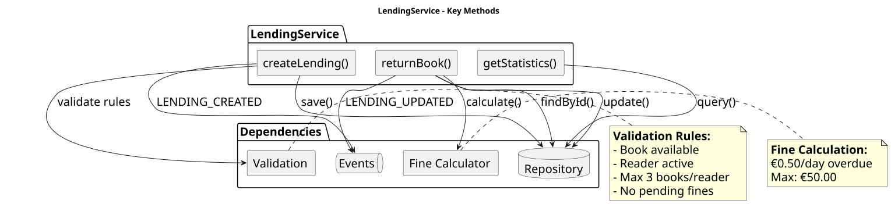

- Métodos da classe LendingService
- Validações complexas (disponibilidade, limites)
- Cálculo de multas
- Fluxo de criação e devolução

#### Vista de Implementação

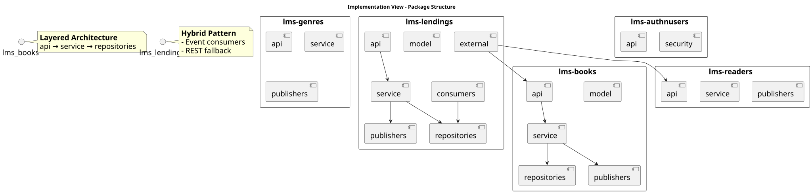

- Organização de packages de todos os micro-serviços
- Layered Architecture (api → service → repositories)
- Domain-Driven Design patterns
- Dependências entre packages

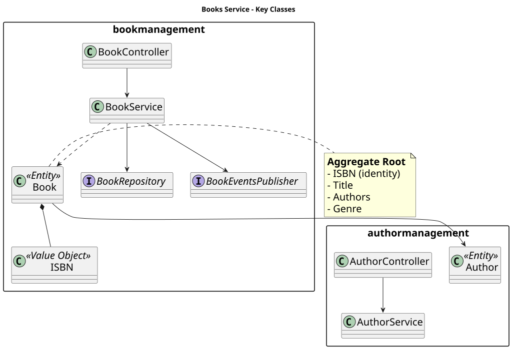

- Estrutura completa de packages do lms-books
- Classes e interfaces específicas
- DTOs, Entities, Value Objects
- Configurações e publishers RabbitMQ

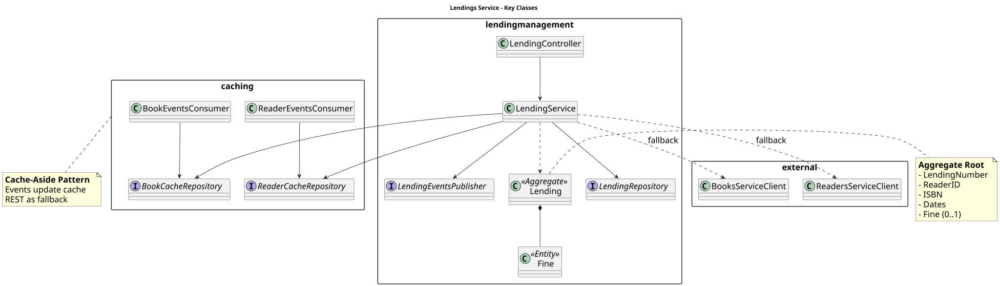

- Estrutura completa de packages do lms-lendings
- Padrões: Cache-Aside, Circuit Breaker
- Consumers e REST clients
- Aggregate Roots e Entities

### Diagramas de Comunicação

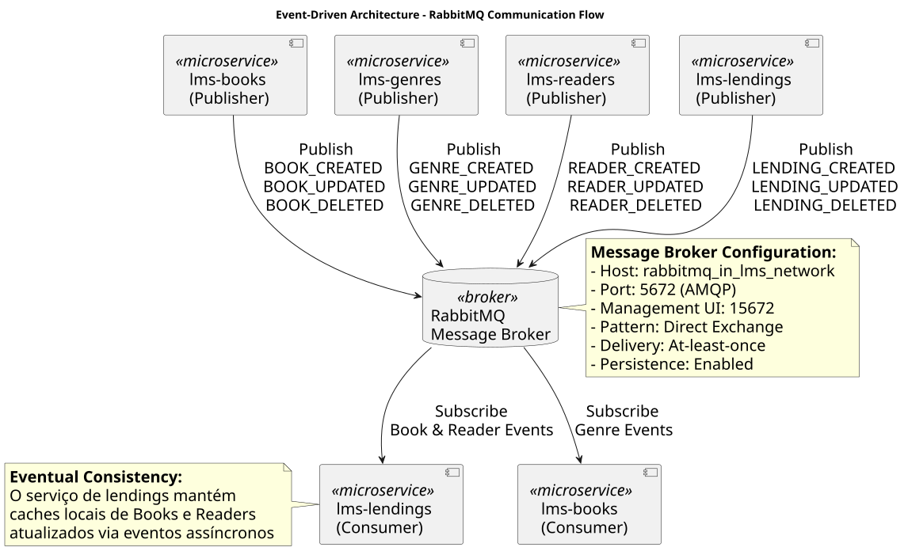

- Padrão Publisher-Subscriber via RabbitMQ
- Eventos publicados por cada micro-serviço:
  - BOOK_CREATED, BOOK_UPDATED, BOOK_DELETED
  - GENRE_CREATED, GENRE_UPDATED, GENRE_DELETED
  - READER_CREATED, READER_UPDATED, READER_DELETED
  - LENDING_CREATED, LENDING_UPDATED, LENDING_DELETED
- Direct Exchange pattern
- Consistência eventual

### Diagramas de Deployment

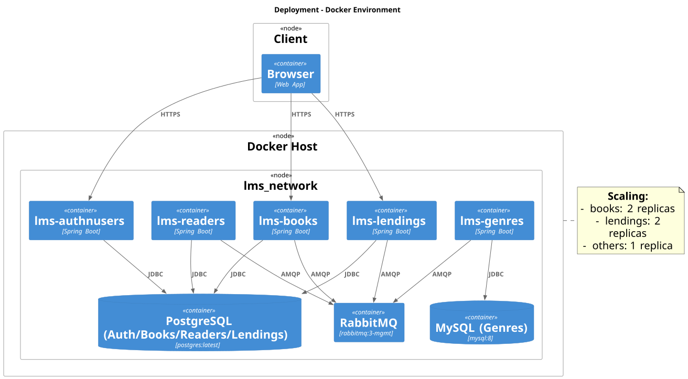

- Arquitetura de containers Docker
- Docker network (lms_network)
- Instâncias múltiplas (scaling):
  - lms-books: 2 replicas
  - lms-lendings: 2 replicas
- Configuração de portas e volumes
- Health checks e restart policies

### Diagramas de Sequência

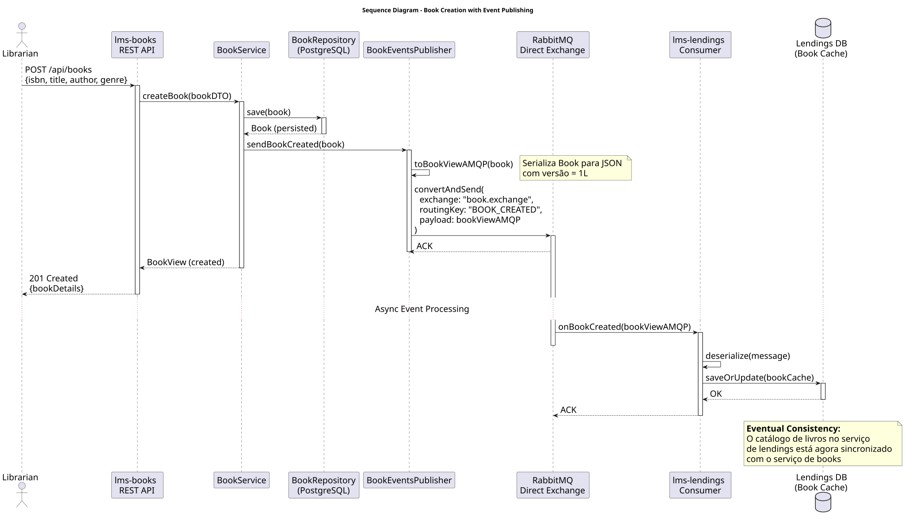

- Fluxo completo de criação de um livro
- Publicação do evento BOOK_CREATED via RabbitMQ
- Consumo assíncrono pelo serviço de lendings
- Atualização de cache local (eventual consistency)

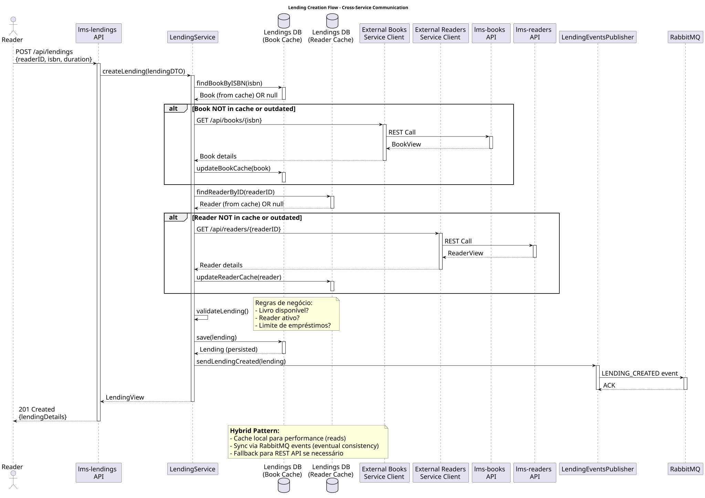

- Fluxo de criação de empréstimo
- Consulta de cache local (Books e Readers)
- Fallback para REST API se cache desatualizado
- Validação de regras de negócio
- Publicação do evento LENDING_CREATED

### Diagramas de Domínio

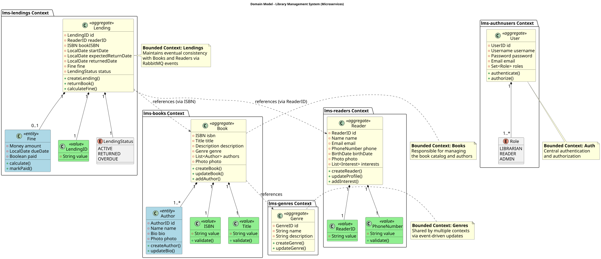

- Agregados por bounded context:
  - Books Context: Book, Author, ISBN, Title
  - Genres Context: Genre
  - Readers Context: Reader, ReaderID, PhoneNumber
  - Lendings Context: Lending, Fine, LendingStatus
  - Auth Context: User, Role
- Relações entre agregados via eventos
- Value Objects e Entities

## Como Gerar os Diagramas

### Pré-requisitos

Os diagramas PlantUML requerem **Graphviz** instalado no sistema:

```bash
# Ubuntu/Debian
sudo apt-get install graphviz

# macOS
brew install graphviz

# Verificar instalação
dot -V
```

### Gerar diagramas

Para gerar os diagramas PlantUML, utilizar o script `generate-plantuml-diagrams.sh` localizado na raiz do projeto (`p2/`). Este script percorre os ficheiros `.puml` no diretório especificado por parâmetro (default para `docs`) e gera os outputs num diretório `/_assets` em cada um dos sub-diretórios de diagramas em `.svg`.

```bash
./generate-plantuml-diagrams.sh docs
```

**Outputs gerados**:

- Diagramas SVG em: `docs/diagrams/_assets/*.svg`
- Ficheiros fonte: `docs/diagrams/*.puml`

**⚠️ Problema conhecido**: Se os SVGs mostram erro "Cannot find Graphviz", instalar Graphviz (ver pré-requisitos acima) e regenerar:

```bash
./generate-plantuml-diagrams.sh docs
```

## Referências

- [C4 Model](https://c4model.com/) - Model for visualising software architecture
- [PlantUML](https://plantuml.com/) - Open-source tool for creating UML diagrams
- [RabbitMQ Documentation](https://www.rabbitmq.com/documentation.html)
- [Spring Boot Microservices](https://spring.io/microservices)
- [Domain-Driven Design](https://martinfowler.com/bliki/DomainDrivenDesign.html)
- [Event-Driven Architecture](https://martinfowler.com/articles/201701-event-driven.html)
